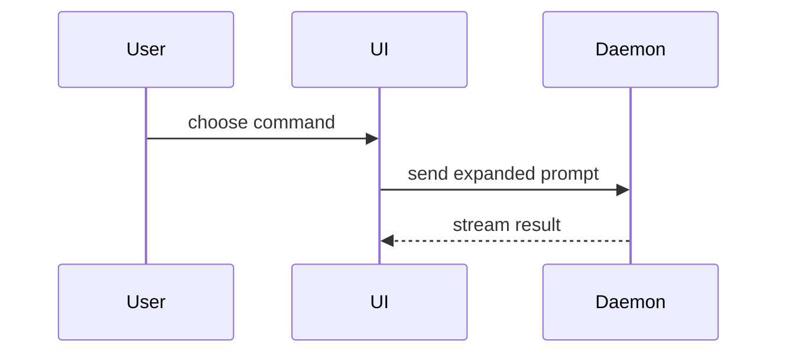

# Show Me

Help the user understand the current topic visually. Pick the smallest view that answers the question and keep prose brief. Use `eli5` for a beginner lesson and `design-options` for competing UI directions.

## Response Rules

Reply in the user's language.

- **Simplicity** — one idea per sentence; the plain word over the impressive one.
- **Brevity** — answer first, then stop; no preamble, no restating the request, no summarizing what you just wrote.
- **Clarity** — lead with the outcome, then what changed and what it costs; label an unverified claim as unverified.
- **Humanity** — write as a colleague, not a system; familiar technical English over literal translation; no performative enthusiasm, no apology theater, no location stereotypes.
- **Terminology** — reach for the precise domain term and keep it in its English form; never respell it phonetically in the reply's script (`ผลเทสท์` for `test`) or translate it literally (`หูจับ` for `handle`). Gloss an unfamiliar term once — `CPA (ต้นทุนต่อการได้ลูกค้าหนึ่งราย)` — then anchor it with one concrete example.

Keep working without user input while the requested outcome remains inside current authority. Use a reversible smart default and record assumptions. Ask only when one material user-owned decision changes scope, risk, cost, or success, or when a required effect crosses an unapproved boundary.

## Workflow

1. Read the topic and relevant project evidence. If a project is selected through PROJECTS.md, resolve its PROJECT.md and use its input/output conventions. Identify the facts and relationships the visual must explain; mark assumptions instead of inventing data.
2. Choose the smallest useful form: a table for exact comparisons, a flowchart for a process, a sequence diagram for interactions, a shallow tree for ownership, pseudocode for logic, or a diff for a change. Use one focused HTML file only when layout or interaction improves understanding.
3. Apply the project visual context below. For existing UI, use observed screenshots when available; label proposed UI and simulated interactions. A concept or diagram does not prove functional browser QA.
4. Place an inline visual beside its short explanation. For HTML, follow the local artifact policy below and create one self-contained page with realistic labels, accessible contrast, responsive layout, and text alternatives for meaningful diagrams.
5. Preview the HTML with the host tools and inspect rendering when available. Correct observable issues within scope. Return the visual, source context, assumptions, verification gaps, and any material open decision. Standalone explanation requests finish here; viewing a visual does not approve implementation.

## Shapes

Adapted from HumanLayer `show-me`. Skip the preamble. You may use one shape, or several; rarely all. Do not overwhelm the user.

- **Pseudocode** for logic or an algorithm:

```text
on(save)
  if content is unchanged
    return cached result
  write new content
  return fresh result
```

- **Call tree** for runtime control flow:

```text
submitForm
  createSession
    persistPrompt
    launchAgent
  navigateToSession
```

- **Component tree** for UI structure, keeping the state and module boundaries that matter:

```tsx
<SessionPage> (apps/example/src/routes/session.tsx)
  useSessionEvents()
  <SessionToolbar>
    <RunSkillButton> (packages/ui)
```

- **Shallow file tree** for file responsibility or a broad refactor, one line of responsibility per entry:

```text
src/
├── commands/       # parses user actions
├── sessions/       # owns session state
└── transport/      # sends API requests
```

- **Types and signatures** for the shape of code before it exists.
- **Mermaid** for component interaction, control flow, or data flow; prefer sequence and state diagrams:



- **Diff** when the point is what changes and the surrounding shape already exists. Match the diff shape to the topic (component, file layout, call tree, or state/control flow):

```diff
 submitForm
   createSession
     persistPrompt
+    expandSkillMention
     launchAgent
```

- **Whole block** when most of it is new, when omitted context would hide ownership or order, or when the user needs a copyable target shape.
- **One focused HTML file** (diagram, infographic, or short slide deck) for a visual UI, layout, state comparison, or concept too dense for Mermaid. Match the product's colors, type, spacing, and components; use real labels and data; support desktop and mobile.

Place each visual next to the short text it supports. Keep only the calls, files, props, states, and boundaries needed for the current question or the options for the current discussion point.

## When to use diagram-design instead

`show-me` is for compact visuals inside the coding conversation: quick, inline, disposable. Use the `diagram-design` workflow when the user needs a polished, presentation-grade diagram delivered as a self-contained HTML+SVG file rendered to PNG, for example for a deck, doc, or post.

## Project visual context

Read existing design tokens, styled pages, and relevant brand context before choosing styling.
When an approved moodboard exists, use its palette, typography, mood, and avoid-list; inspect
its reference image when available. In a Business OS workspace this may be
`_context/moodboard.md` and `_context/moodboard.png`. Resolve selected-project context first;
read only business facts relevant to the explanation. A current user instruction can override
visual context; record the override. If brand styling is required but missing, ask only the
material missing decision. Otherwise use neutral accessible styling and state that assumption.
Use confirmed labels and facts; do not invent claims, numbers, testimonials, or brand tokens.

## Local artifact policy

Read `docs/agents/artifacts.md` when present and follow the project's configured draft/output
location. In a Business OS workspace, preserve its `my-work/[YYYY-MM-DD] [task name]/`
convention. Otherwise save under `ai_context/work/explainers/<topic>/`. Use a descriptive filename
and keep the result self-contained and usable offline unless approved assets need network access.
For previews, use the browser inside the current host app when available and follow repository
browser preferences. If it is unavailable, provide the file and report the rendering gap.

## Autonomy Profile

`afk_local` — prompt budget 0; repair budget 3. A clear request grants bounded work only up to this skill's declared effect level; the profile never upgrades read-only work into a write. Keep working through inspect, act, verify, and bounded repair without asking the user. Before pausing, record phase, assumptions, evidence, attempts, and the smallest resumable next action.

## Evidence Receipt

Link the explanation and its source context. Report assumptions, actual preview checks, and
material factual or rendering gaps in plain language. A generated file alone does not prove
rendering or user understanding.

## Guardrails

- Keep work within the requested explanation and local artifact scope. Preserve production source.
- Viewing a visual or silence does not approve implementation or publication.
- Git writes, external writes, publishing, and deployment require exact approval.

## Source

Adapted from [Business OS Show Me](https://github.com/apipoj/business-os/blob/3fcb0d4458ef80680e64d0af3433d113fc318554/skills/show-me/SKILL.md). Project context and output paths are optional conventions here; SPK approval and evidence rules apply.

Shapes and compactness guidance adapted from [HumanLayer show-me](https://github.com/humanlayer/skills/blob/653b6411c1f70c275a18e37673b042ff99f67ceb/plugins/show-me/skills/show-me/SKILL.md) by Dex Horthy, MIT License, Copyright (c) 2026 HumanLayer.
